## All aboard at Roma Street

First trip: Roma Street to Cleveland, on Moreton Bay. Just under an hour, east through the suburbs to the water.

Roma Street is mid-makeover, its glass entrance hall flanked by hoardings for the new Cross River Rail station.

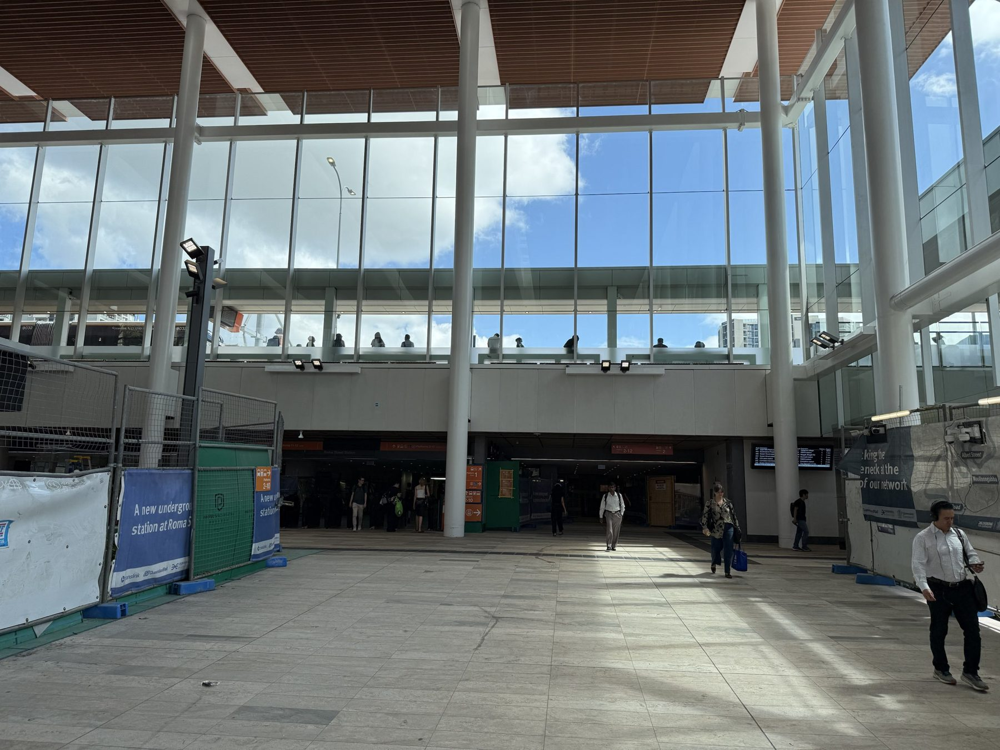

## Along the line

I caught the 9:20 from platform 5: 21 stops, from South Brisbane through the inner suburbs and down the bayside run from Wynnum to Cleveland.

The carriage was nearly empty, so I had my pick of window seats.

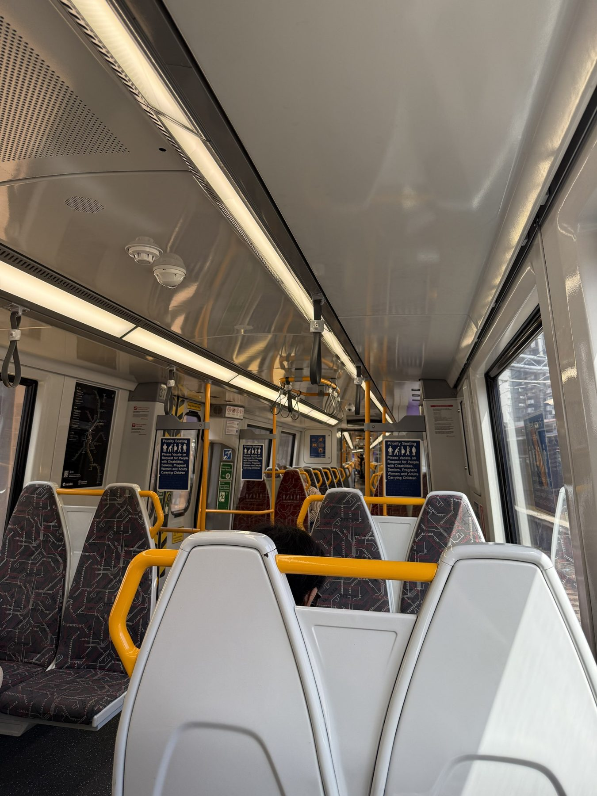

Minutes later we crossed the river on the Merivale Bridge, with the William Jolly Bridge and the city towers framed in the window.

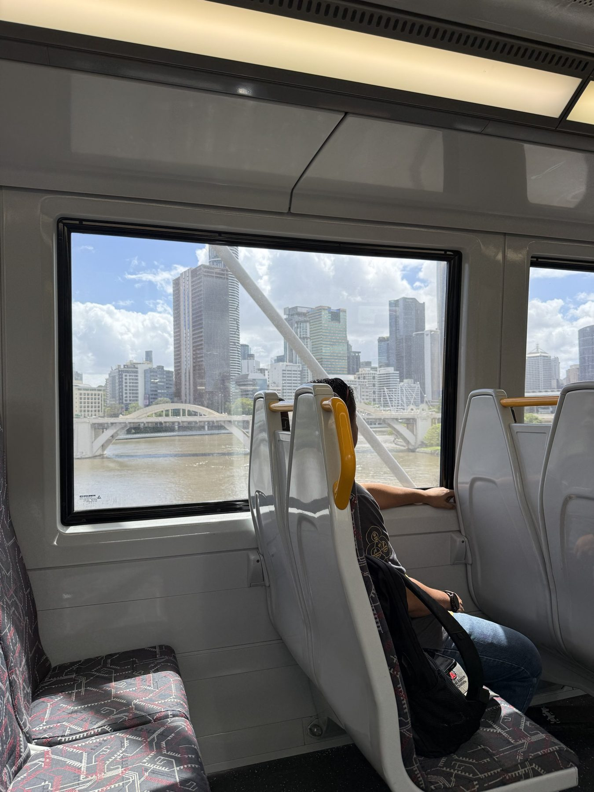

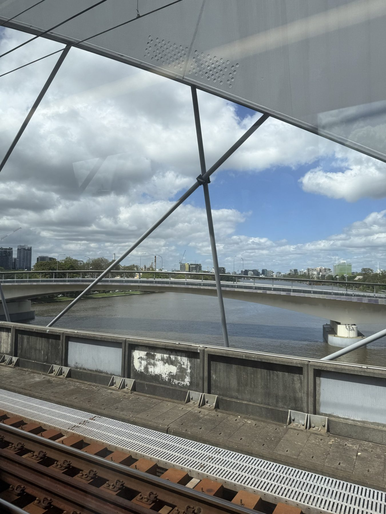

Near Boggo Road, concrete arches with a fan of steel rods curve over the track, an old riveted truss bridge running alongside.

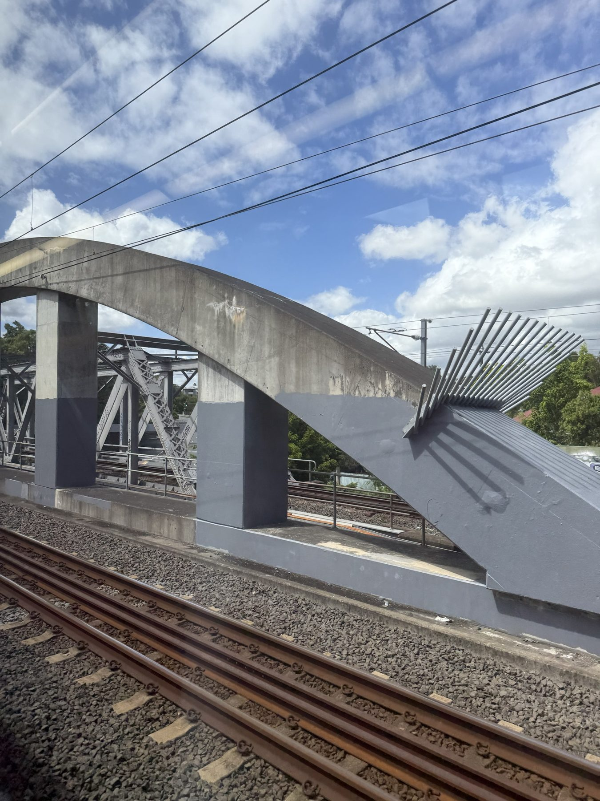

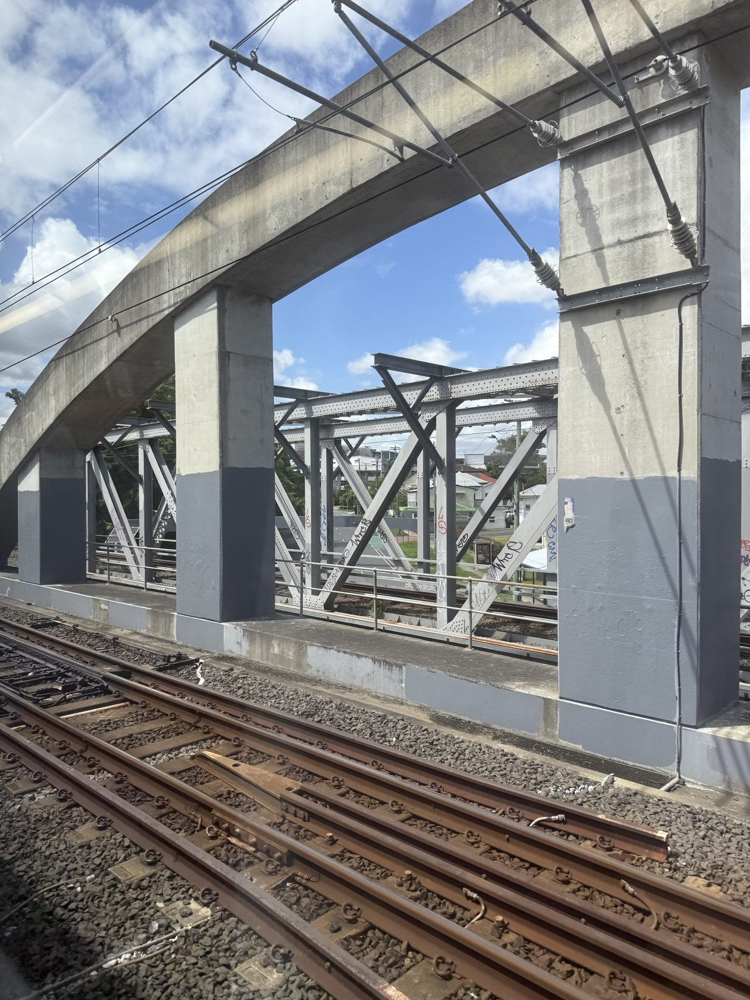

Past the inner suburbs the city falls away, and mangroves before Hemmant hint at the bay.

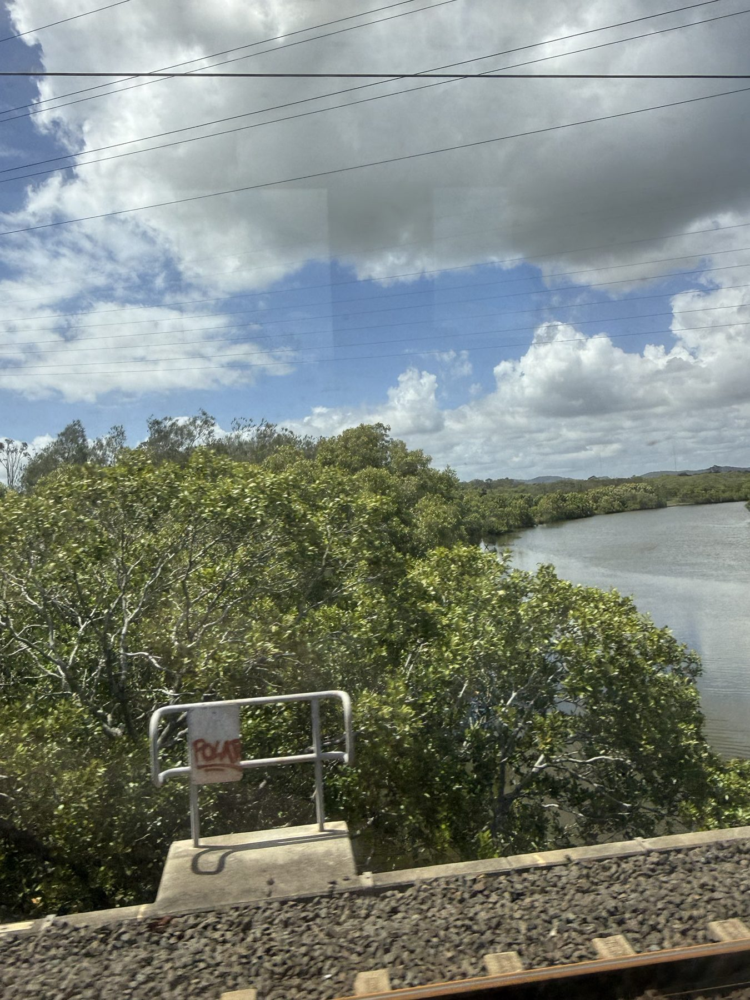

Further on, between Thorneside and Birkdale, the line crosses Tingalpa Creek, wide and lined with mangroves.

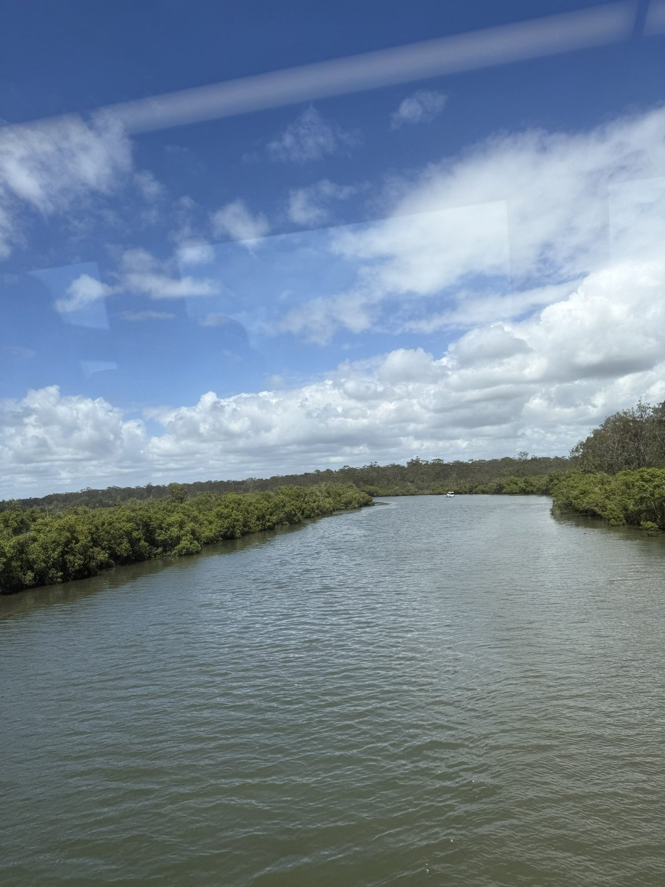

## Arriving at Cleveland

Cleveland station is small and quiet, under gum trees. I didn't expect much from the town beyond it. I was wrong.

## Christmas by the harbour

A short walk away, Norfolk pines line the harbour at Raby Bay. The council's Christmas tree is already up by the water, red and gold baubles under a blue sky.

## Shopping and eating in town

The real surprise: a busy town centre. Past Cleveland Library, the main street is lined with flowering poincianas, small shops and cafés.

Behind it is Cleveland Central, a full shopping centre whose exits are named after the bay islands. I left via Russell Island.

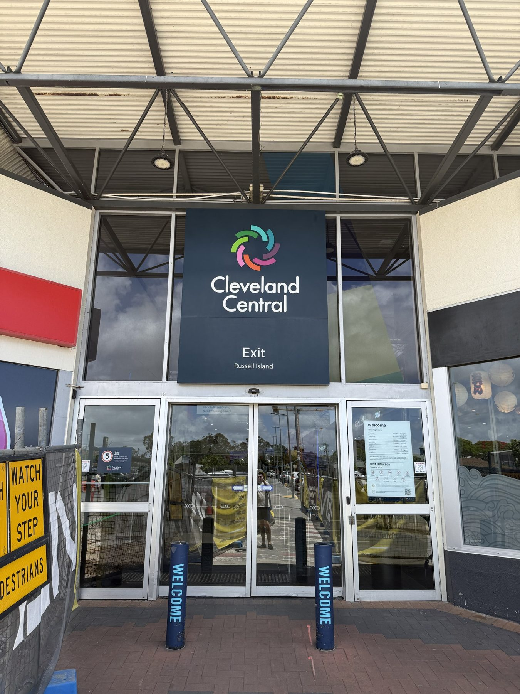

Far more to eat and buy than I expected at the end of a suburban line.

## Down to the bay

Raby Bay's marina sits right in town, yachts still on glassy water.

A foreshore path runs past lawns and pines to the bay, with boats at anchor and islands on the horizon. Quiet, breezy and perfect for a picnic.

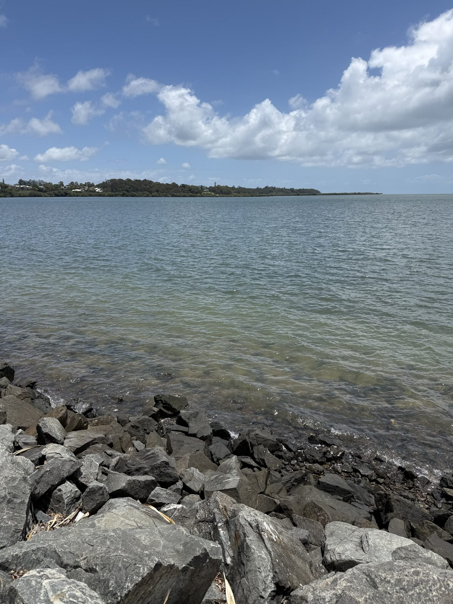

One last look at the marina on the way back.

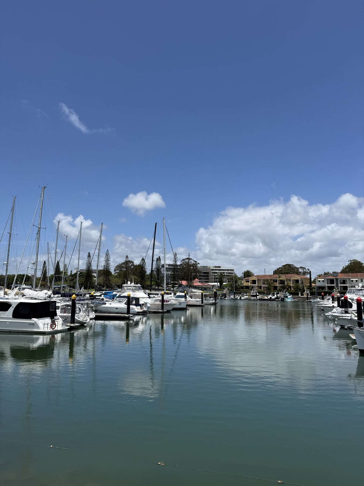

## Heading home

Trains run back every half hour. I took the 11:39, which runs through to Shorncliffe, the end of another line, for another day.

## At the end of the line: Cleveland

- **Shop:** main street shops and Cleveland Central
- **Eat:** cafés, restaurants and the centre's dining strip
- **Walk:** Raby Bay marina and the foreshore path
- **Relax:** shady lawns by the bay
- **Seasonal:** the harbour Christmas tree
- **Getting there:** about an hour from Roma Street, trains every 30 minutes

I came for the end of the line and found a proper bayside town.
