## All aboard at Roma Street

I started at Roma Street in the heart of Brisbane and rode the Cleveland line to the end, on the shore of Moreton Bay. The line runs east through the inner suburbs and out to the bay, a little under an hour door to door.

The station itself is in the middle of a makeover. The entrance is a tall glass hall full of morning light, with construction hoardings on either side announcing a new underground station at Roma Street, part of the Cross River Rail project.

## Along the line

At 8:55 the departures board had the 9:20 to Cleveland on platform 5.

By 9:07 I was on platform 5, where the board listed all 21 stops: South Brisbane, South Bank, Boggo Road, Buranda, Coorparoo, Norman Park, Morningside, Cannon Hill and Murarrie, then the bayside run of Hemmant, Lindum, Wynnum North, Wynnum, Wynnum Central, Manly, Lota, Thorneside, Birkdale, Wellington Point and Ormiston, and finally Cleveland.

Then train 746 pulled in with Cleveland on its destination screen, and I climbed aboard.

The carriage was bright and almost empty, so I had my pick of window seats. Just after 9:20 we pulled out of Roma Street, sliding past the long covered platforms on our way out of the city.

A few minutes later we were crossing the Brisbane River on the Merivale Bridge. Through the steel bracing I could see the white arches of the William Jolly Bridge, the brown river below and the city towers behind, before the train rolled into South Brisbane.

After South Bank, the line ran out over another bridge just before Boggo Road. Long concrete arches curved over our track, finished at one end with a fan of steel rods, and through them I could see an old riveted steel truss bridge running alongside.

Past the inner suburbs the city fell away. Just before Hemmant the train crossed a wide creek lined with mangroves, the first real sign that we were nearing the bay.

## Arriving at Cleveland

A little after Ormiston the train slowed for the last time and stopped under the gum trees at Cleveland, the end of the T4 line. The station is small and quiet, more country platform than city terminus, and I honestly wasn't expecting much from the town beyond it. I was wrong.

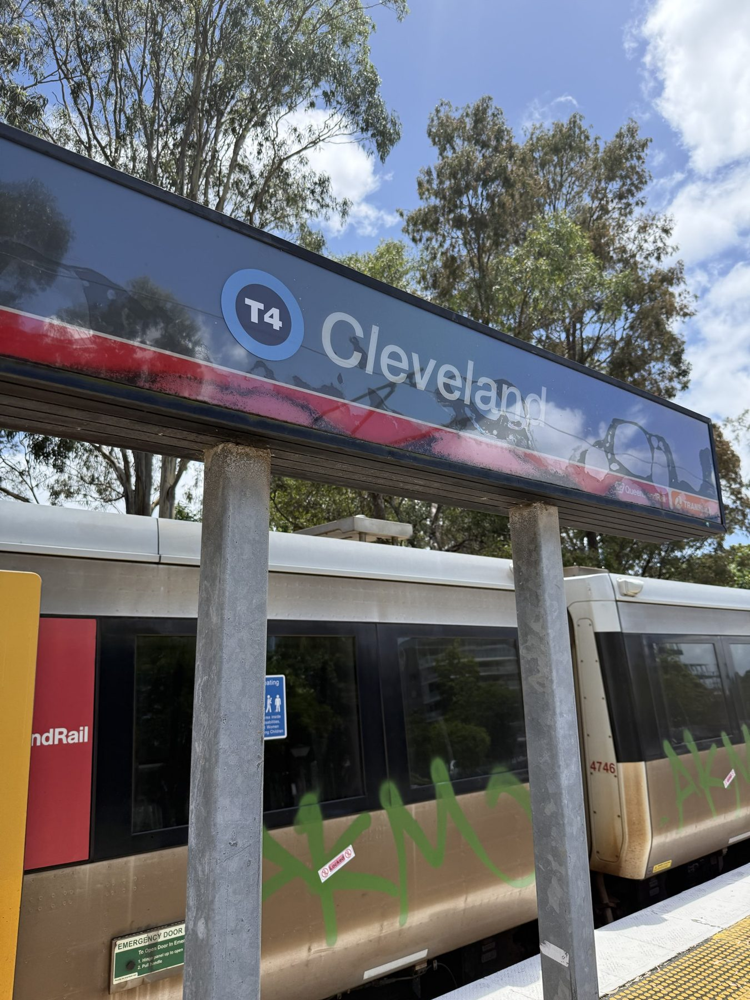

## Christmas by the harbour

A short walk from the station, a row of tall Norfolk pines lines the road along the harbour, with yachts and the townhouses of Raby Bay just behind them. In the park on the waterfront, Redland City Council had already put up its Christmas tree: a tall tree covered in red and gold baubles, fenced off with a white picket fence and topped with a wire star. A poster on the fence advertised the official tree lighting, with live music and a movie in the park. Nothing says Queensland Christmas like baubles under a blue sky and a sea breeze.

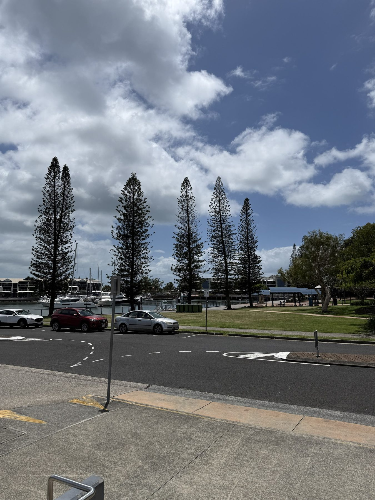

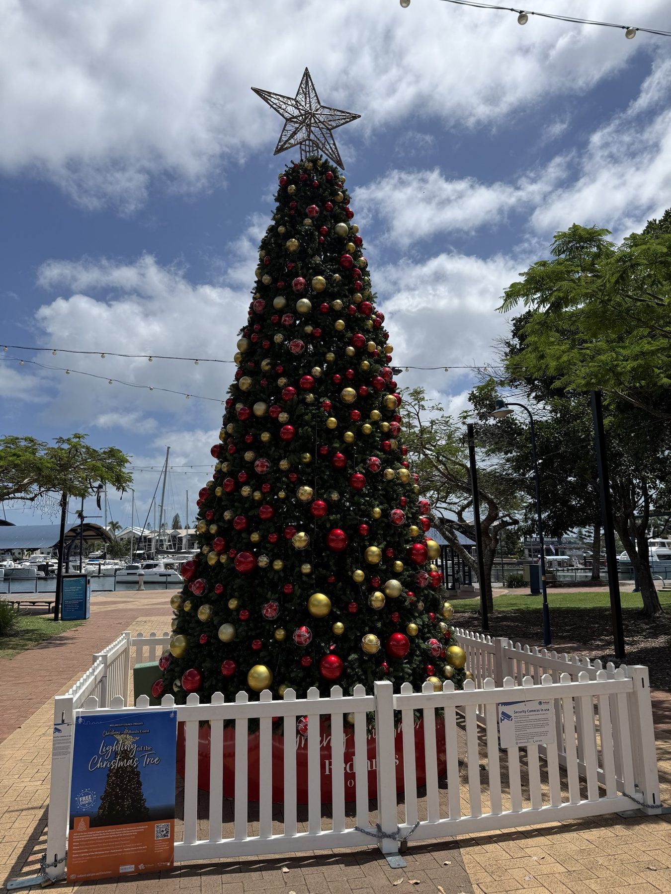

## Shopping and eating in town

This was the real surprise. Cleveland has a proper town centre, and it's busy. Up the steps and past Cleveland Library, the main street is lined with poinciana trees in full, flaming red bloom, with benches in their shade and small shops underneath: florists, real estate agents, cafés and restaurants with tables outside.

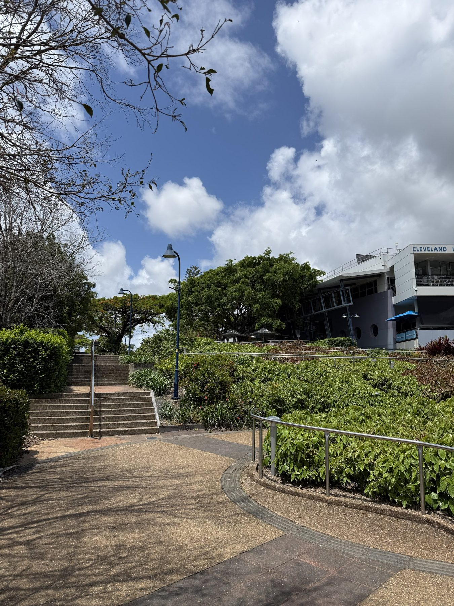

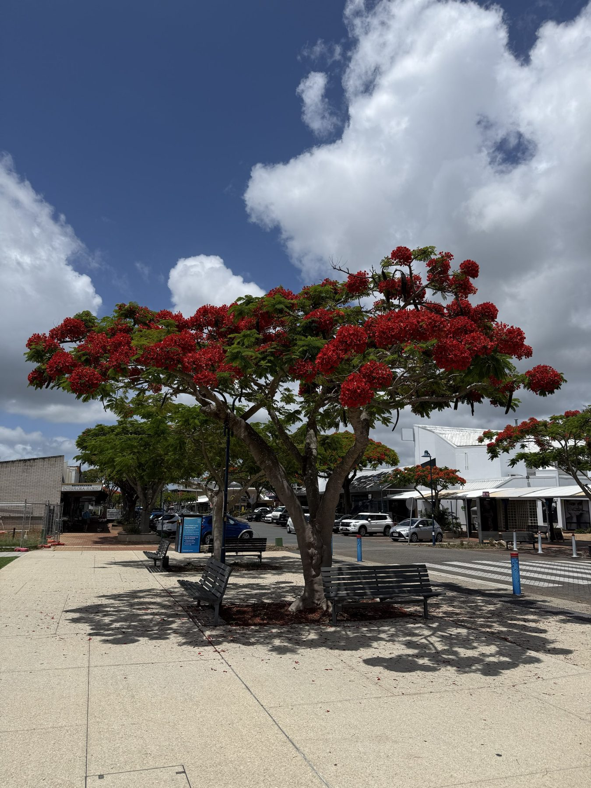

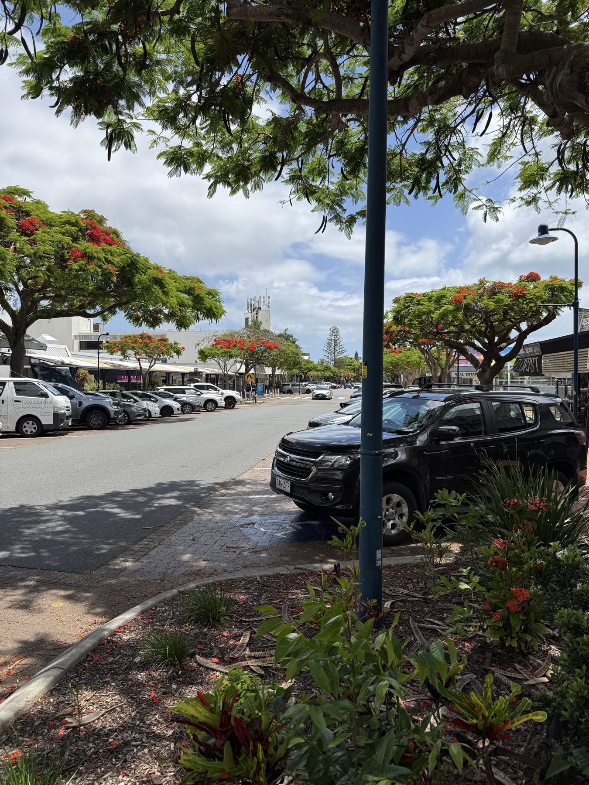

Just behind is Cleveland Central, a full shopping centre with a Woolworths and a dining strip. Its entrances are named after the bay islands, so I left through the "Russell Island" exit, which is about as close to island hopping as a shopping trip gets.

Between the main street and the centre there was far more choice for lunch and shopping than I'd expected at the end of a suburban train line. You could easily spend a few hours here without going near the water.

## Down to the bay

Then the water. Raby Bay's marina is right in town, packed with yachts and cruisers sitting perfectly still on glassy water, with Norfolk pines and apartments around the edge.

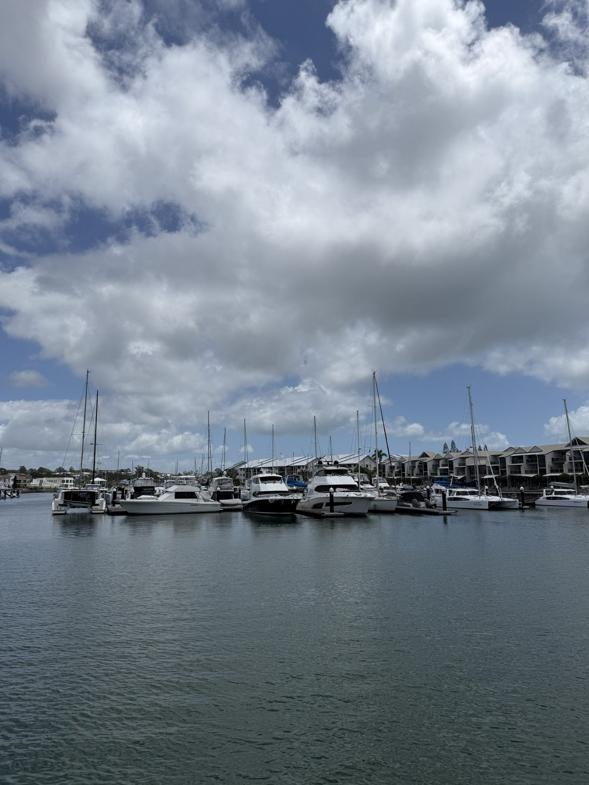

A path runs along the foreshore past wide lawns, pandanus palms and lines of Norfolk pines, with a rock wall dropping down to the bay. Out on Moreton Bay, sailboats sat at anchor, low green islands stretched along the horizon and big clouds rolled over the water. It was breezy, mostly empty and very peaceful. Bring a picnic, find some shade under a pine and you could stay all afternoon.

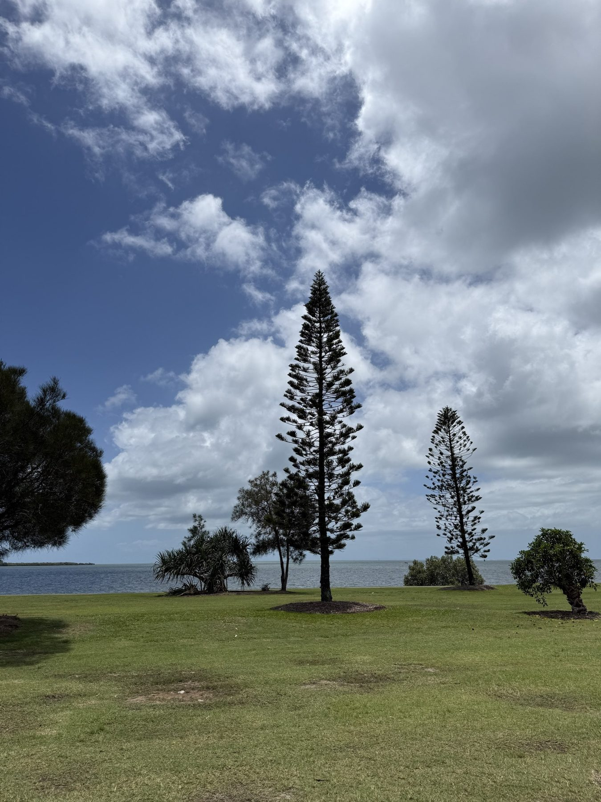

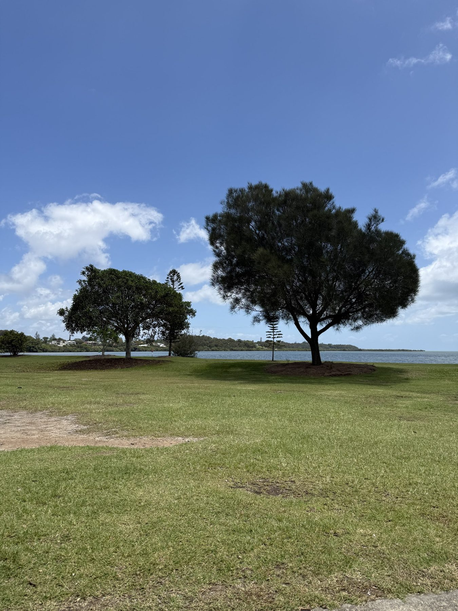

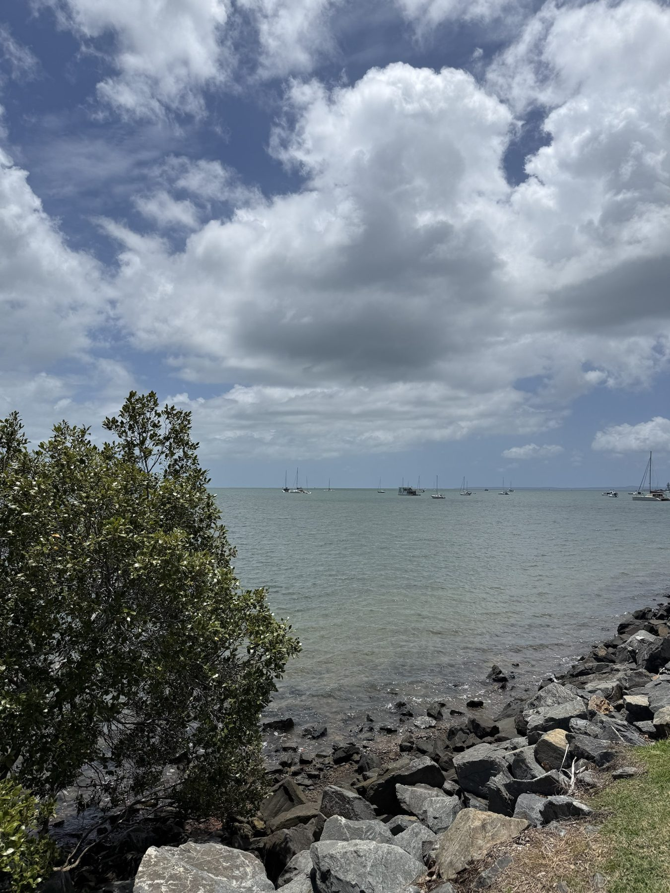

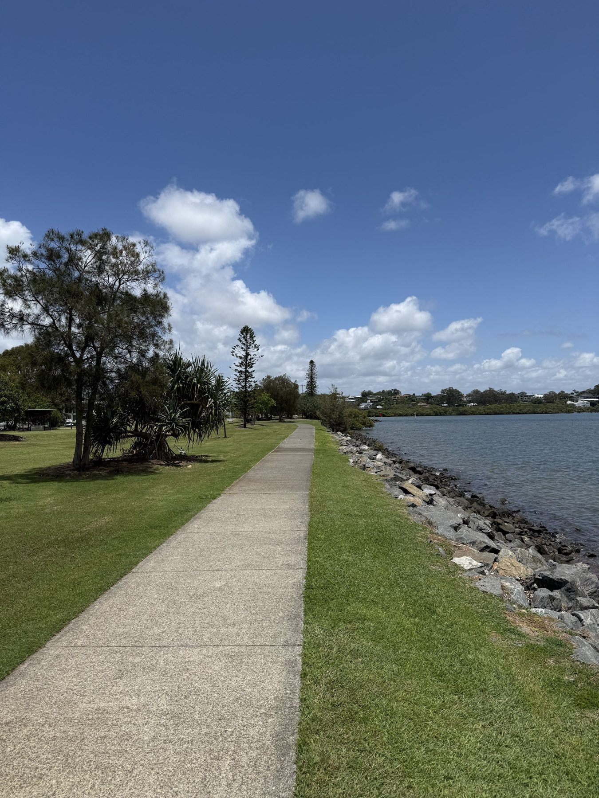

On the way back I passed the marina one more time, the clouds building up over the masts.

## Heading home

Back at the station, the board had trains to the City and Shorncliffe every half hour. I caught the 11:39 from platform 1, a sleek new-generation train that would carry me straight back through Roma Street and on across the north side to Shorncliffe, at the end of a different line, for another day.

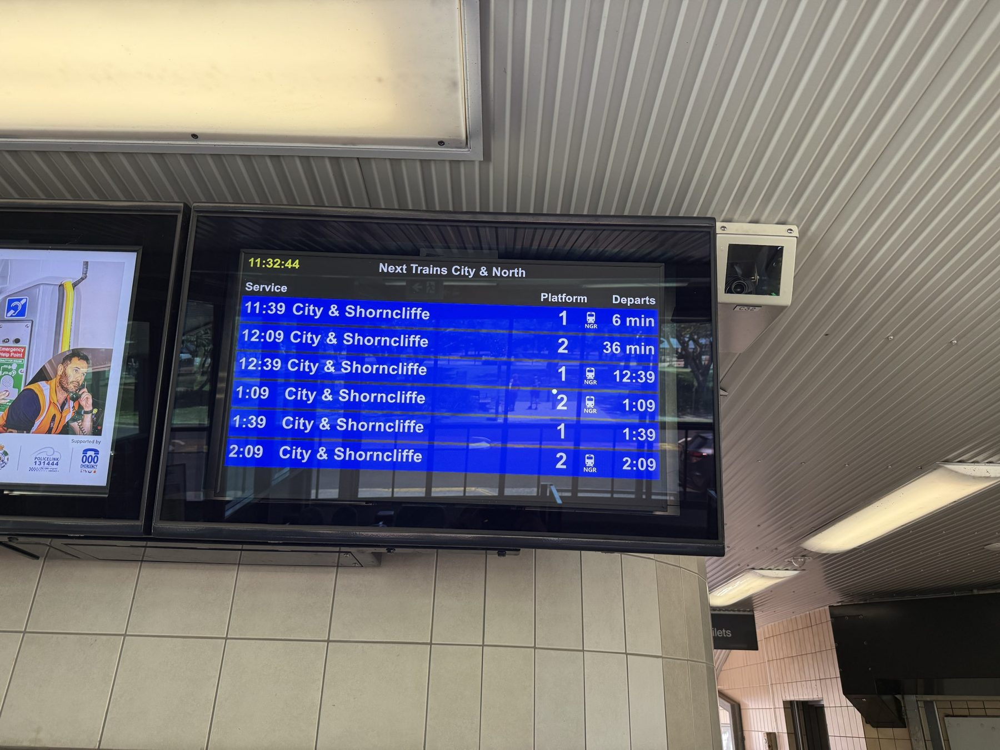

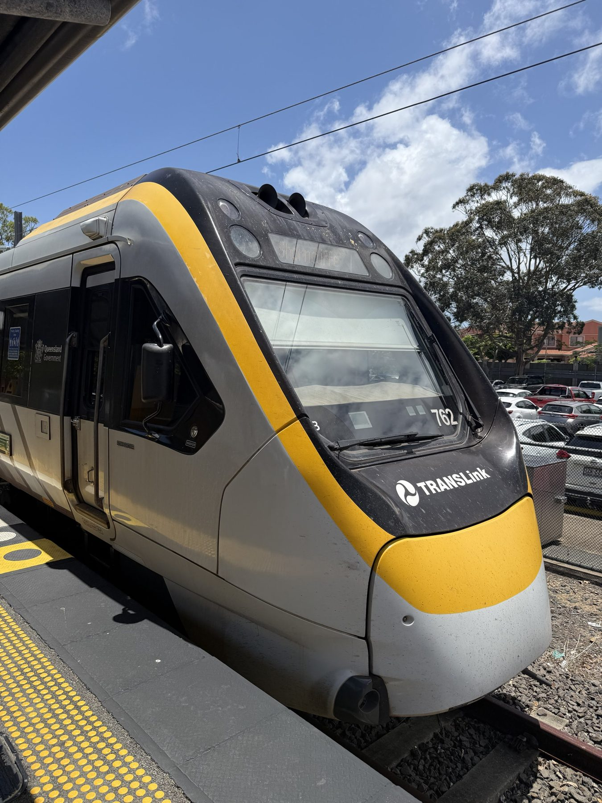

## At the end of the line: Cleveland

- **Shop:** the main street's small shops plus Cleveland Central, a full shopping centre with a supermarket
- **Eat:** cafés and restaurants along the main street and the centre's dining strip
- **Walk:** Raby Bay marina and the foreshore path along Moreton Bay
- **Relax:** shady lawns and Norfolk pines by the water, good for a picnic
- **Seasonal:** the council Christmas tree by the harbour in November and December
- **Getting there:** about an hour from Roma Street on the Cleveland line, with trains back every 30 minutes

Cleveland surprised me. I came for the end of the line and found a proper bayside town, with plenty to eat, plenty to buy and one of the nicest views of the bay in Brisbane.
